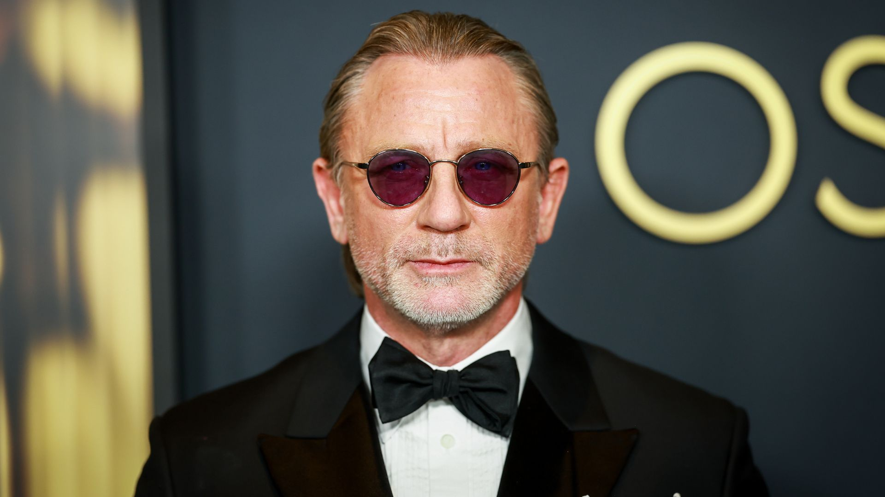

Robert Pattinson foi anunciado oficialmente como o novo intérprete de James Bond. A Amazon MGM Studios confirmou, em 16 de novembro de 2026, a escolha do ator para protagonizar o próximo filme da franquia, encerrando as especulações sobre quem assumiria o papel após Daniel Craig. A produção será dirigida por Denis Villeneuve, com roteiro de Steven Knight.

Em comunicado divulgado após o anúncio, Pattinson afirmou que interpretar o agente secreto representa uma das maiores conquistas de sua carreira. O ator também agradeceu à equipe responsável pelo projeto e destacou a expectativa de trabalhar com os profissionais envolvidos na produção.

*“James Bond é um dos personagens mais lendários do cinema, e ser escolhido para interpretar o 007 é a maior honra da minha vida”*, declarou o ator.

Villeneuve também comentou a escolha e afirmou que Pattinson apresenta características capazes de renovar a interpretação do personagem.

*“Ele tem a alma atemporal de 007 e traz um espírito completamente novo. Mal posso esperar para começar”*, afirmou o diretor.

## Produção reúne nomes de destaque de Hollywood

O próximo filme de James Bond terá produção de Amy Pascal e David Heyman, com Tanya Lapointe na produção executiva. Pascal é conhecida por seu trabalho na franquia Homem-Aranha, enquanto Heyman participou da produção dos filmes de Harry Potter.

A direção ficará sob responsabilidade de Villeneuve, cineasta conhecido pela franquia Duna e por produções como A Chegada e Blade Runner 2049. O roteiro será escrito por Steven Knight, criador da série Peaky Blinders.

Até o momento, a Amazon MGM Studios não divulgou o título oficial, detalhes da trama ou a data de estreia do longa-metragem.

## Pattinson sucede Daniel Craig no papel de 007

A escolha de Robert Pattinson marca uma nova fase para a franquia, que teve Daniel Craig como protagonista durante cinco filmes. O ator britânico estreou como James Bond em 2006, com 007 - Cassino Royale, e encerrou sua participação em 2021, com 007 - Sem Tempo Para Morrer.

No último longa, o personagem se sacrifica para impedir uma ameaça global, encerrando a trajetória de Craig como o agente secreto.

A sucessão também ocorre após mudanças no controle da franquia. Em 2025, a Amazon MGM Studios assumiu o controle criativo de James Bond por meio de um acordo com os produtores históricos Michael G. Wilson e Barbara Broccoli.

A nova produção será a primeira aventura cinematográfica do agente sob a nova estrutura criativa do estúdio.

## Outros atores estavam entre os cotados para o papel

Antes da confirmação, diversos nomes foram especulados como possíveis sucessores de Daniel Craig. Entre eles estavam Callum Turner, Jack Lowden, Nicholas Hoult, Josh O'Connor, Aaron Taylor-Johnson, Harris Dickinson, Tom Francis, Jacob Elordi e Harry Styles.

As especulações ganharam força durante o processo de seleção, especialmente após informações sobre testes de elenco envolvendo alguns dos candidatos.

Pattinson também passou a ser apontado como um dos favoritos após surgirem notícias sobre sua participação nas audições, ao lado de Nicholas Hoult.

## Ator acumula experiência em grandes franquias

A escolha de Pattinson ocorre em um momento de destaque de sua carreira em Hollywood. O ator ganhou projeção internacional ao interpretar Edward Cullen na saga Crepúsculo e, posteriormente, ampliou sua trajetória com produções independentes e filmes de grandes estúdios.

Em 2022, assumiu o papel de Bruce Wayne em The Batman, dirigido por Matt Reeves. O ator também integra o elenco de Duna: Parte Três, novamente sob direção de Denis Villeneuve, e tem retorno previsto ao universo da DC com The Batman Part II, programado para 2028.

Em comunicado conjunto, os produtores Amy Pascal e David Heyman elogiaram a versatilidade do ator e destacaram sua capacidade de se reinventar profissionalmente.

*“A coragem de Robert como ator, seu humor autodepreciativo e sua capacidade de se reinventar continuamente fazem dele o Bond perfeito para os nossos tempos”,* afirmaram.

Com a confirmação, Robert Pattinson passa a integrar a lista de atores que deram vida ao agente secreto criado pelo escritor Ian Fleming. A expectativa agora gira em torno dos primeiros detalhes da produção e da nova interpretação de um dos personagens mais conhecidos da história do cinema.

---

**Fontes:**

- [DUNN, Jack; SHAFER, Ellise. *Robert Pattinson Is Officially James Bond: Meet the New 007 Actor*. Variety, 17 nov. 2026.](https://variety.com/2026/film/global/robert-pattinson-new-james-bond-007-1236946655/)
- MURRAY, Emily. *Robert Pattinson is the new James Bond*. Amazon MGM Studios, 16 nov. 2026.

