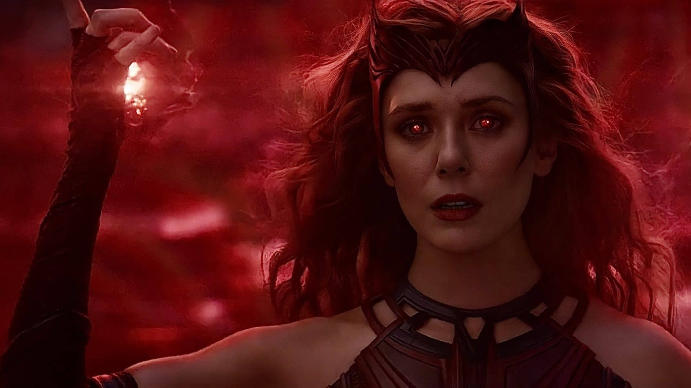
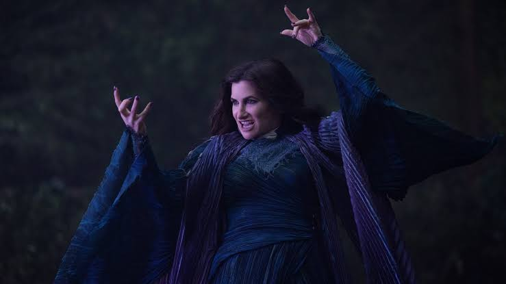
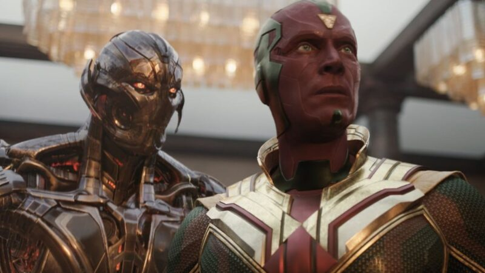
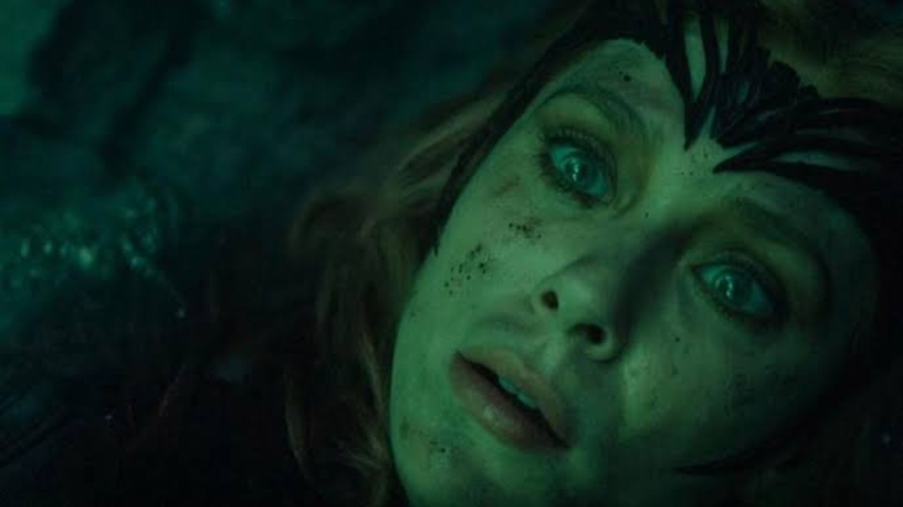

> Atenção: o texto contém spoilers dos finais de WandaVision, Agatha Desde Sempre e VisionQuest.

Na noite de terça-feira (10), tivemos o encerramento de uma trilogia que começou em 2021, com WandaVision, passou por Agatha Desde Sempre e chegou ao seu desfecho em VisionQuest. Foram cinco anos acompanhando personagens capazes de alterar a realidade, enfrentar a morte e desafiar as próprias regras da existência. Mas, depois de tantas batalhas, revelações e reencontros, a pergunta que fica talvez seja muito mais simples: o que realmente faz uma família ser família? Amor? Obsessão? Laços sanguíneos? A necessidade de pertencer a algum lugar? A trilogia nos apresenta uma família que desafia qualquer definição convencional e, justamente por isso, parece mais próxima da nossa realidade do que gostaríamos de admitir.

Uma mãe que muda o mundo por amor. Um pai que busca em si mesmo uma identidade que só consegue assumir plenamente quando reencontra os filhos. Filhos que, no luto da perda do que nunca tiveram, lutaram como super-heróis para recuperar alguma coisa que pudesse ser chamada de família. Há afeto, saudade, competição, conflitos, abandono e desejo de pertencimento. Há também uma questão que acompanha toda essa história: quando o amor se torna tão grande que ameaça a liberdade de quem está ao nosso redor, ainda podemos reconhecê-lo como amor?

## Wanda: quando amar significa não conseguir perder

Wanda Maximoff perdeu quase tudo: a família, o irmão, o companheiro e, finalmente, a possibilidade de uma vida comum. Sua história é marcada por perdas sucessivas, como se a vida insistisse em retirar justamente aquilo que lhe permitiria encontrar algum descanso. Em WandaVision, esse luto se transforma em obsessão, e a pequena cidade de Westview passa a existir dentro do sonho de uma mulher que não consegue aceitar mais uma despedida. Entretanto, antes de julgá-la, talvez seja necessário fazer uma pergunta desconfortável: se nós, que não somos mutantes nem super-heróis, já tentamos modificar o mundo por amor, o que alguém com os poderes de Wanda seria capaz de fazer?

Wanda nunca almejou conquistar a humanidade. Wanda nunca almejou conquistar o país. Wanda só almejou conquistar a normalidade. E tudo em volta dela nunca foi normal. Perdeu a família em Sokovia, aliou-se a um vilão por vingança, fez de tudo por amor. Para Wanda, a maior conquista seria botar os filhos para dormir, seria fazer o jantar, seria assistir à TV. Em [WandaVision](https://www.imdb.com/pt/title/tt9140560/), as passagens de tempo, as mudanças de cenário e até a maneira de contar a história fazem referência a séries consagradas sobre a vida em família, a convivência e o amor. Wanda só queria ser normal. E nada na tragédia dela nos é estranho. Nós perdemos, nós lutamos e nós mudaremos o mundo por tudo.

Talvez seja esse o grande desconforto de WandaVision: não estamos diante de uma vilã que desconhece o amor, mas de uma mulher que ama tanto que já não consegue suportar a possibilidade de perder. A pergunta deixa de ser apenas o que Wanda fez e passa a ser o que nós faríamos se pudéssemos impedir uma despedida. Aceitaríamos a perda ou tentaríamos, de todas as formas possíveis, construir uma realidade em que ela nunca tivesse acontecido?

## Agatha: o amor, a culpa e aquilo que não conseguimos reparar

Em Agatha Desde Sempre, a história encontra outra mulher marcada pela perda de um filho. Agatha Harkness parece, durante boa parte da série, alguém movida exclusivamente pelo desejo de poder. É cruel, manipuladora e disposta a sacrificar outras pessoas para sobreviver. Mas a descoberta de sua relação com Nicholas Scratch acrescenta uma dimensão trágica à personagem. Por trás da bruxa que aprendemos a temer existe uma mãe que não conseguiu salvar o filho e que transformou a lembrança dele em parte de sua própria história de violência.

Será que Agatha e Wanda são muito diferentes mesmo? Será que a oposição que sempre apareceu entre elas existe de verdade? Ou são duas mulheres que compartilham uma tragédia? Será que isso, no final das contas, não faz Agatha salvar Billy e Billy salvar Agatha? Não seria uma espécie de reflexo da relação entre Wanda e Billy, em que um tenta salvar o outro? É uma substituição. Mas é uma substituição baseada no desespero.

A história de Agatha também nos faz pensar sobre o perdão. Há pessoas que conseguem conviver com o julgamento do mundo, mas não suportam o julgamento que fazem de si mesmas. Talvez a maior punição de Agatha não seja a morte, a solidão ou a perda dos poderes, mas a dificuldade de acreditar que ainda poderia ser amada por alguém que conhecesse tudo o que ela fez.

## Visão: do navio de Teseu à montanha de Sísifo

Um dos momentos mais marcantes de WandaVision foi o encontro entre duas versões do Visão e a discussão sobre o navio de Teseu. Se todas as peças de um navio forem substituídas, ele continua sendo o mesmo? E se as peças originais forem reunidas novamente, qual dos dois será o verdadeiro navio? A metáfora é especialmente poderosa para um personagem cuja existência desafia a própria ideia de humanidade. O Visão que conhecemos morreu, mas suas memórias, sua consciência e partes de sua identidade continuam presentes em outras formas. Afinal, o que faz alguém continuar sendo quem é?

Entretanto, depois de VisionQuest, penso que a verdadeira metáfora da história do Visão talvez não seja mais o navio de Teseu, mas a montanha de Sísifo. Na interpretação de Albert Camus, Sísifo é condenado a empurrar uma pedra montanha acima, sabendo que ela voltará a cair e que precisará recomeçar. É uma imagem do esforço que se repete, mesmo quando não existe a promessa de uma conclusão definitiva. E talvez seja justamente isso que tenha faltado a Wanda e ao Visão: tempo para construir uma vida e, principalmente, tempo para aproveitá-la. 

Nas histórias de super-heróis, tudo parece acontecer em flashes. São batalhas, viagens, ameaças ao universo e despedidas que chegam antes de qualquer rotina se estabelecer. O pouco tempo que Wanda e Visão tiveram juntos, atravessado pelos acontecimentos de Guerra Infinita, transforma-se em um eco da vontade de voltar a carregar a pedra pela montanha. Porque nada substitui o trabalho árduo e cotidiano de construir alguma coisa. Uma família não nasce pronta de uma declaração de amor, de uma lembrança ou de uma promessa. Ela se forma nas repetições, nos erros, nas reconciliações e na insistência em permanecer presente.

Por isso, o reencontro do Visão com Billy e Tommy, no encerramento de VisionQuest, tem um significado que ultrapassa a recuperação de suas memórias. O personagem passou tanto tempo tentando descobrir quem era que talvez a resposta estivesse menos em suas peças e mais nas relações que ainda poderia construir. Os filhos, por sua vez, carregam lembranças e saudades de uma vida familiar interrompida antes que pudessem realmente vivê-la. Quando se encontram, não recuperam simplesmente o passado. Eles encontram a possibilidade de começar alguma coisa.

## É preciso imaginar Wanda feliz

O encerramento de VisionQuest ainda reserva uma última surpresa. Na cena pós-créditos, Doutor Destino aparece diante de Wanda Maximoff, retira os escombros que a encobriam e ordena que ela desperte. A família que parecia definitivamente destruída volta a ter uma possibilidade de futuro, embora a série ainda não mostre como ou em que condições esse reencontro poderá acontecer. Depois de cinco anos, a Marvel encerra sua trilogia sem eliminar todas as perguntas. Talvez porque a mais importante delas não possa ser respondida por um superpoder.

Em O mito de Sísifo, Camus nos convida a imaginar Sísifo feliz. Depois de acompanhar Wanda, Agatha, Visão, Billy e Tommy, fico pensando se não deveríamos fazer o mesmo com essa família. Será que precisamos imaginar Wanda feliz? Quem, em sã consciência, não seria capaz de se tornar vilão pelos próprios filhos? Uma leoa deve ser julgada por defender sua prole? São perguntas difíceis justamente porque o amor pode nos levar a atitudes que, vistas de fora, jamais aceitaríamos. Isso não elimina a dor de quem sofre as consequências dessas escolhas, mas talvez nos obrigue a reconhecer que nem sempre somos tão diferentes daqueles que condenamos. 

No final, a família da Marvel parece mais com a nossa do que queremos admitir. Tem erro, tem dor, tem sofrimento, tem perda, tem abandono. Mas, acima de tudo, tem amor. E o amor conserta tudo. O amor perdoa, mesmo que ninguém perdoe. Talvez não seja possível recuperar o tempo perdido, desfazer todas as escolhas ou reconstruir exatamente aquilo que um dia existiu. Ainda assim, permanece a possibilidade de tentar outra vez, de carregar a pedra montanha acima e encontrar, nesse esforço, alguma felicidade.

E talvez tenha chegado o momento de perdoar. E de nos perdoarmos.

  
